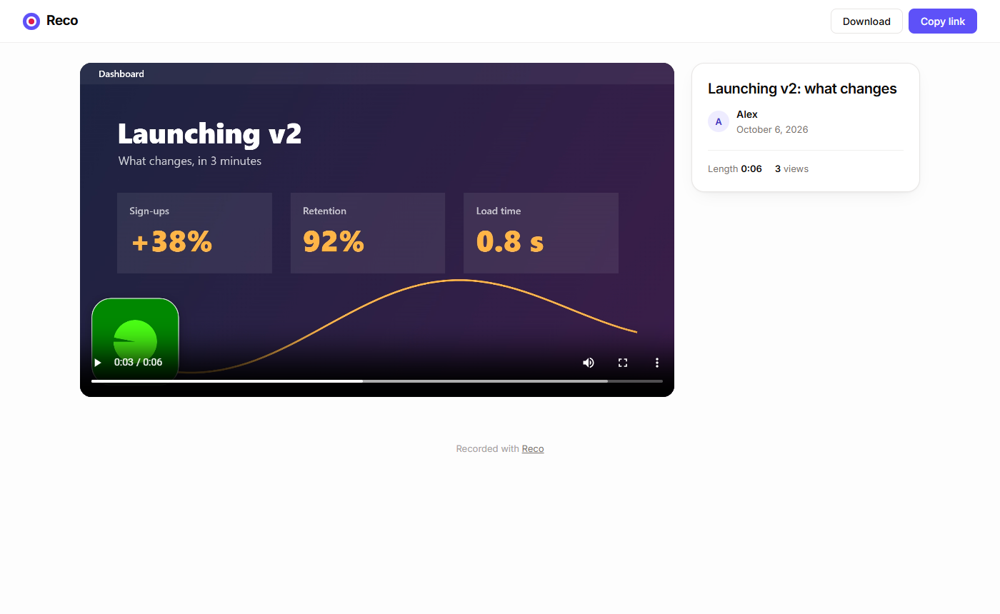
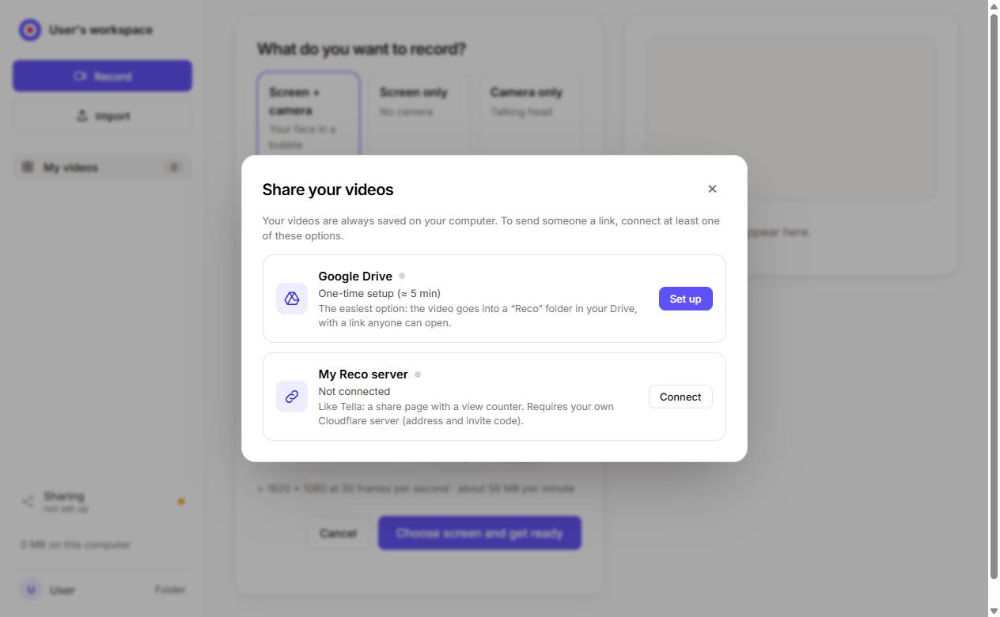
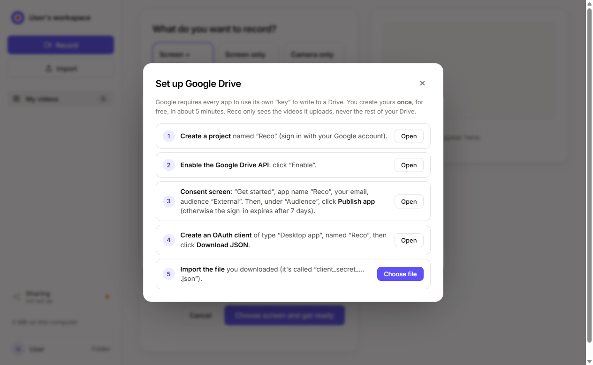

# Reco

**Record your screen and camera, share the video with a simple link. Free, open source, self-hosted.**
A free alternative to Loom or Tella for you and your friends.

[](https://deploy.workers.cloudflare.com/?url=https://github.com/69H69/reco)


## What it does

- **3 modes**: screen + camera (your face in a bubble), screen only, camera only. Microphone and computer audio.
- **Floating mini window** while recording, always on top: your camera, the timer, pause, stop, **restart**, and hide / resize / move the bubble live.
- **Constant frame rate** at **30 or 60 fps**, **720p to 4K**: Reco encodes the video itself, so editors read it without drift.
- **Link ready as soon as you stop**: the video uploads *while* you record (8 MB chunks, automatic retries). No length limit.
- **Share page** that works everywhere (desktop, iPhone, Android), with seeking, download, and thumbnail previews in WhatsApp, iMessage, Slack…
- **Shared library** with your friends: titles, durations, view counts, rename, trim start and end, delete (everyone manages only their own videos).
- **Import** an existing video (MP4, WebM, MOV), e.g. exported from [Cap](https://github.com/CapSoftware/Cap) or OBS, to share it by link.
- **Invite code** required to record; share links open without an account.

| Set up | Share | Share page |
|---|---|---|
|  |  |  |

## Two ways to use Reco

1. **Desktop app, no server** (the simplest): install Reco, record, and the video is **saved on your computer** (`Videos\Reco` folder). At the end of the recording, choose how to share it:
   - **Google Drive**: the video goes to *your* Drive (15 GB free) and the link is copied;
   - **My Reco server**: for the **full Tella experience** (share page, views, online library, link previews), publish to *your own Cloudflare server* (see “Installation” below; Cloudflare asks for a card to enable R2 storage, free up to 10 GB). In the app: sidebar > *Sharing* > *My Reco server* > *Connect* (address, first name, invite code).
2. **Website only** (on your Cloudflare server): record in Chrome or Edge, nothing to install.

| Sharing options | Google Drive setup |
|---|---|
|  |  |

## Desktop app (Windows and Mac)

Like Tella, Reco comes as an **installable app** (`desktop/`, Electron). It adds:
- **its own screen or window picker**, with thumbnails, and **computer audio** captured directly;
- a **control window that stays on top and is invisible in the video** (timer, pause, stop, restart, bubble);
- the main window **gets out of the way while recording** and comes back when you stop;
- a tray icon and the **Ctrl+Shift+R** shortcut (start / stop);
- **“Restart”** while recording (discards the take and restarts the countdown, without asking for the screen again) and **“Redo”** on the end screen;
- **quality** (720p, 1080p, 1440p or the screen's resolution up to 4K) and **frame rate** (30 or 60 fps), remembered between recordings;
- a layout that adapts to small windows (the sidebar collapses to icons).

**Constant frame rate**: the video is encoded by Reco itself (WebCodecs H.264 + AAC, muxed into MP4 by [mp4-muxer](https://github.com/Vanilagy/mp4-muxer)) rather than by `MediaRecorder`. Frame n always gets timestamp n / fps; if the screen or camera falls behind, the previous frame is repeated. The result is a video at a **constant** 30 or 60 fps that editing software reads without drift, with audio aligned on the same clock. Pauses leave no gap.

It works on its own (videos on the computer). A Reco server's site also offers a **“Download the app”** link (`/download`), which serves installers uploaded to R2:
```bash
cd desktop && npm install && npm run dist          # builds dist/Reco-Setup-x.y.z.exe
npx wrangler r2 object put reco-videos/apps/Reco-Setup.exe --file desktop/dist/Reco-Setup-1.1.0.exe --remote   # same for apps/Reco-arm64.dmg and apps/Reco-x64.dmg
```
The installer is not code-signed: on first launch, Windows shows “Windows protected your PC”. Click *More info*, then *Run anyway*.

**Mac** (`Reco-x.y.z-arm64.dmg` for Apple Silicon M1–M4 Macs, `x64` for Intel Macs): open the `.dmg` and drag Reco into Applications. The app is not signed by Apple: on first launch, right-click Reco and choose *Open*. If macOS says it is “damaged”, run `xattr -cr /Applications/Reco.app` in Terminal. macOS then asks for permission to record the screen (System Settings > Privacy & Security > Screen Recording). On Mac, computer audio is not captured yet (microphone only).

**Building the installers**: the repo's *Actions* tab (“Desktop app” workflow) builds the `.dmg` and `.exe` on GitHub's machines and checks that the app starts. Pushing a `v1.1.0` tag publishes a *release* with the files.

**Google Drive sharing**: Reco does not ship any Google key. Each user creates their own once, for free: in the app, *Sharing* > *Google Drive* > *Set up* opens a 5-step wizard (with direct links to Google Cloud) and imports the `client_secret_….json` file. Reco only asks for the `drive.file` scope: it can see the videos it uploads, never the rest of the Drive. (If you distribute your own build, you can bundle a key in `desktop/google-client.json` or the `GOOGLE_CLIENT_JSON` repo secret.)

## How much does it cost?

**$0** on Cloudflare's free tier: Workers (100,000 requests/day) and R2 (**10 GB of storage, free egress**, roughly 4–5 hours of 1080p video).
Watching a video costs nothing, however many views. Cloudflare may ask for a card to enable R2, even when staying on the free tier.

## Installation

### One click
1. Click **Deploy to Cloudflare** above and connect your (free) Cloudflare account.
2. Fill in the two secrets:
   - `INVITE_CODE`: the code you'll give to the people allowed to record (pick a long one);
   - `SESSION_SECRET`: a long random string (e.g. `openssl rand -base64 48`).
3. It's live at `https://reco.<your-account>.workers.dev`.

### By hand
```bash
git clone https://github.com/69H69/reco && cd reco
npm install
npx wrangler login
npx wrangler r2 bucket create reco-videos
npx wrangler secret put INVITE_CODE
npx wrangler secret put SESSION_SECRET
npm run deploy
```

### Locally
```bash
cp .dev.vars.example .dev.vars   # then set a code and a secret
npm run dev                      # http://localhost:8787
```

## Good to know

- **To record: Chrome or Edge on a computer** (or the desktop app). Reco uses *WebCodecs*, *MediaStreamTrackProcessor* and *Document Picture-in-Picture*, which Firefox and Safari don't fully support yet. Share links work everywhere.
- Videos are **MP4 (H.264 + AAC)**, or H.264 + Opus if the browser has no AAC encoder.
- **Trimming** hides the start and end during playback; the downloaded file stays complete.
- The compositor and encoder run in a *Web Worker*, so the recording doesn't freeze when the Reco tab goes to the background.
- Security: signed sessions (HMAC-SHA256, `HttpOnly` cookie), random 12-character video IDs, links that can't be guessed but are **public to anyone who has them**. Pick a long invite code.

## Tests

End-to-end tests with a driven browser and a fake camera, microphone and screen.
```bash
npm run dev                      # in one terminal
pip install playwright           # once
python tests/e2e.py screen+cam 25          # web app: pause, upload while recording, link, trim, views, chunked import, permissions, Range, duration
cd desktop && node test.mjs                # desktop app: constant frame rate, 30/60 fps, restart, redo, pause, sharing (Drive simulated)
```

## Architecture

```
desktop/       Electron desktop app (picker, system audio, control window, tray, local library, Drive, server publishing) + installer
public/        the app (HTML/CSS/JS, no framework) + comp.js (compositor + encoder in a Web Worker) + mp4-muxer
src/worker.js  Cloudflare Worker API: sign-in, multipart upload to R2, /v/:id (share page),
               /f/:id (video, with Range), /t/:id (thumbnail), views, trim
```
No database: each video has a small JSON metadata file in R2.

## License

MIT. See [LICENSE](LICENSE).
