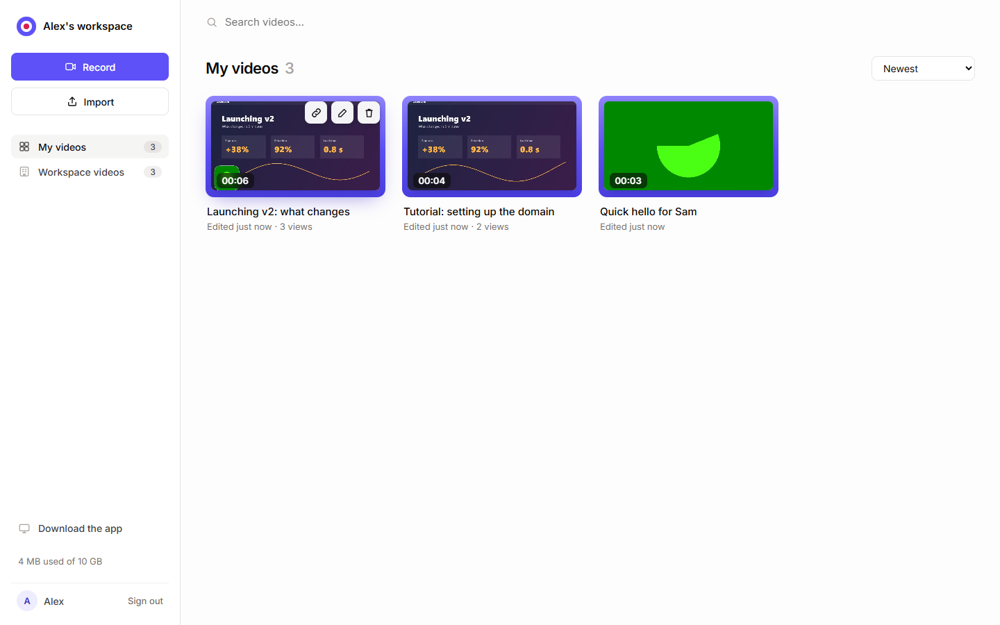
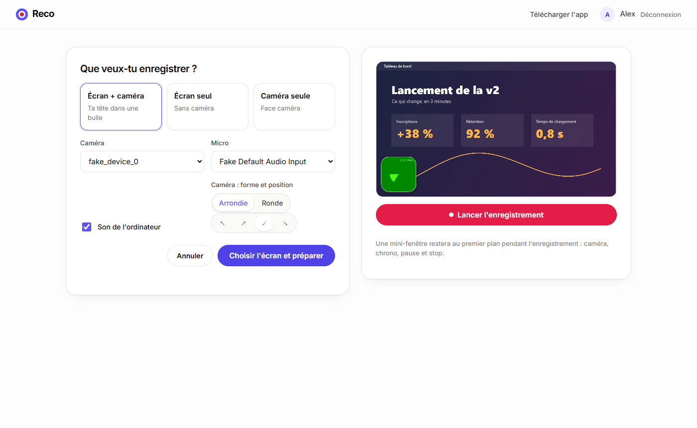
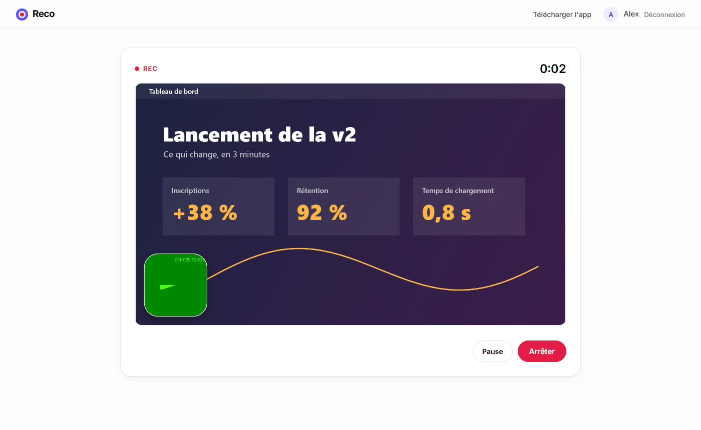
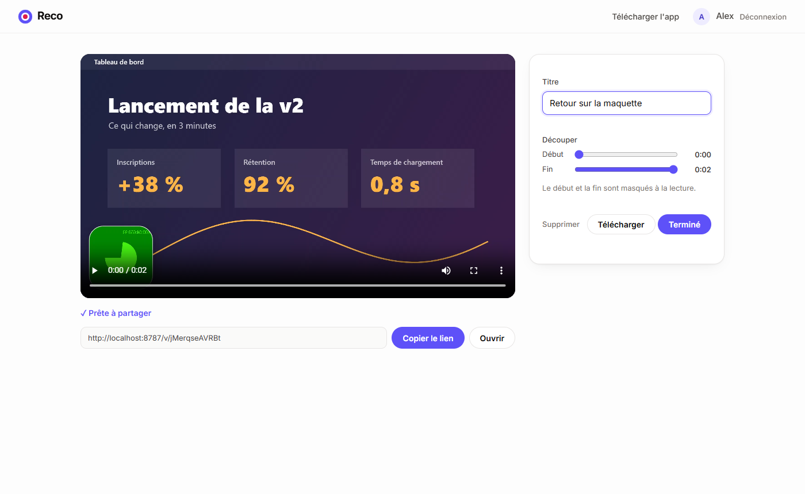

# Reco

**Enregistre ton écran et ta caméra, partage la vidéo avec un simple lien. Gratuit, open source, hébergé chez toi.**
*Record your screen and camera, share it with a link. Free, open source, self-hosted. — English below.*

[](https://deploy.workers.cloudflare.com/?url=https://github.com/69H69/reco)



## Ce que ça fait

- **3 modes** : écran + caméra (ta tête dans une bulle ronde), écran seul, caméra seule. Micro et son de l'ordinateur.
- **Mini-fenêtre flottante** pendant l'enregistrement, toujours au premier plan : ta caméra, le chrono, pause, stop, et masquer / agrandir / déplacer la bulle en direct.
- **Lien prêt dès que tu arrêtes** : la vidéo part en ligne *pendant* que tu enregistres (morceaux de 8 Mo, nouvelles tentatives automatiques). Pas de limite de durée.
- **Page de partage** lisible partout (ordinateur, iPhone, Android), avance rapide, téléchargement, aperçu avec miniature sur WhatsApp, iMessage, Slack…
- **Bibliothèque partagée** avec tes potes : titres, durées, nombre de vues, renommer, découper le début et la fin, supprimer (chacun ne gère que ses vidéos).
- **Importer** une vidéo existante (MP4, WebM, MOV), par exemple exportée de [Cap](https://github.com/CapSoftware/Cap) ou d'OBS, pour la partager par lien.
- **Accès par code d'invitation** pour enregistrer ; les liens partagés s'ouvrent sans compte.

| Préparer | Enregistrer | Partager |
|---|---|---|
|  |  |  |

## Appli de bureau (Windows)

Comme Tella, Reco existe en **appli à installer** (`desktop/`, Electron). Elle ajoute :
- **son propre sélecteur** d'écran ou de fenêtre, avec miniatures, et le **son de l'ordinateur** capturé directement ;
- une **fenêtre de contrôle toujours au premier plan et invisible dans la vidéo** (chrono, pause, stop, bulle) ;
- la fenêtre principale qui **se range pendant l'enregistrement** et revient à l'arrêt ;
- une icône dans la barre système et le raccourci **Ctrl+Maj+R** (lancer / arrêter).

Au premier lancement, elle demande l'adresse de ton serveur Reco. Le site propose aussi un lien **« Télécharger l'app »** (`/download`), qui sert l'installateur déposé dans R2 :
```bash
cd desktop && npm install && npm run dist          # fabrique dist/Reco-Setup-x.y.z.exe
npx wrangler r2 object put reco-videos/apps/Reco-Setup.exe --file desktop/dist/Reco-Setup-1.0.0.exe --remote
```
L'installateur n'est pas signé numériquement : au premier lancement, Windows affiche « Windows a protégé votre ordinateur ». Clique sur *Informations complémentaires*, puis sur *Exécuter quand même*.

## Combien ça coûte ?

**0 €** dans l'offre gratuite de Cloudflare : Workers (100 000 requêtes/jour) et R2 (**10 Go de stockage, bande passante gratuite**, soit environ 4 à 5 h de vidéo 1080p).
Regarder une vidéo ne coûte rien, quel que soit le nombre de vues. Cloudflare peut demander une carte bancaire pour activer R2, même en restant dans l'offre gratuite.

## Installation

### En un clic
1. Clique sur **Deploy to Cloudflare** ci-dessus et connecte ton compte Cloudflare (gratuit).
2. Renseigne les deux secrets demandés :
   - `INVITE_CODE` : le code que tu donneras à tes potes pour pouvoir enregistrer (choisis-en un long) ;
   - `SESSION_SECRET` : une longue chaîne aléatoire (par exemple `openssl rand -base64 48`).
3. C'est en ligne sur `https://reco.<ton-compte>.workers.dev`.

### À la main
```bash
git clone https://github.com/69H69/reco && cd reco
npm install
npx wrangler login
npx wrangler r2 bucket create reco-videos
npx wrangler secret put INVITE_CODE
npx wrangler secret put SESSION_SECRET
npm run deploy
```

### En local
```bash
cp .dev.vars.example .dev.vars   # puis mets un code et un secret
npm run dev                      # http://localhost:8787
```

## Bon à savoir

- **Pour enregistrer : Chrome ou Edge sur ordinateur.** La mini-fenêtre utilise l'API *Document Picture-in-Picture* et le compositeur utilise *MediaStreamTrackProcessor*, deux technologies qui n'existent pas encore dans Firefox ni Safari. Les liens de partage, eux, marchent partout.
- La vidéo est en **MP4 (H.264 + AAC)** quand le navigateur sait le produire (Chrome et Edge récents), sinon en WebM.
- La **découpe** masque le début et la fin à la lecture ; le fichier téléchargé reste complet.
- Le compositeur tourne dans un *Web Worker* et suit le rythme des images de la caméra : la bulle ne gèle pas quand l'onglet de Reco passe en arrière-plan.
- Sécurité : sessions signées (HMAC-SHA256, cookie `HttpOnly`), identifiants de vidéo aléatoires de 12 caractères, liens non devinables mais **publics pour qui les possède**. Choisis un code d'invitation long.

## Tests

Test de bout en bout avec un navigateur piloté (caméra, micro et écran factices) : enregistrement avec pause, envoi pendant l'enregistrement, lien, découpe, vues, import en plusieurs morceaux, droits de suppression, Range, durée du fichier.
```bash
npm run dev            # dans un terminal
pip install playwright # une fois
python tests/e2e.py screen+cam 25
```

## Architecture

```
desktop/       appli de bureau Electron (sélecteur, son système, fenêtre de contrôle, barre système) + installateur
public/        appli (HTML/CSS/JS sans framework) + comp.js (compositeur en Web Worker)
src/worker.js  API Cloudflare Worker : connexion, envoi multipart vers R2, /v/:id (page de partage),
               /f/:id (vidéo, avec Range), /t/:id (miniature), vues, découpe
```
Pas de base de données : chaque vidéo a un petit fichier JSON de métadonnées dans R2.

---

## English

Reco is a free, open-source, self-hosted alternative to Loom or Tella for you and your friends: record your **screen + camera bubble**, a **floating mini-window** stays on top while recording (camera, timer, pause, stop, move or resize the bubble), the video **uploads while you record**, and you get a **share link** the moment you stop. The share page works on any device, with link previews.
Runs entirely on Cloudflare's free tier (Workers + R2: 10 GB storage, free egress). Recording requires Chrome or Edge on desktop. Click **Deploy to Cloudflare** above, set `INVITE_CODE` and `SESSION_SECRET`, done.

## Licence

MIT. Voir [LICENSE](LICENSE).
